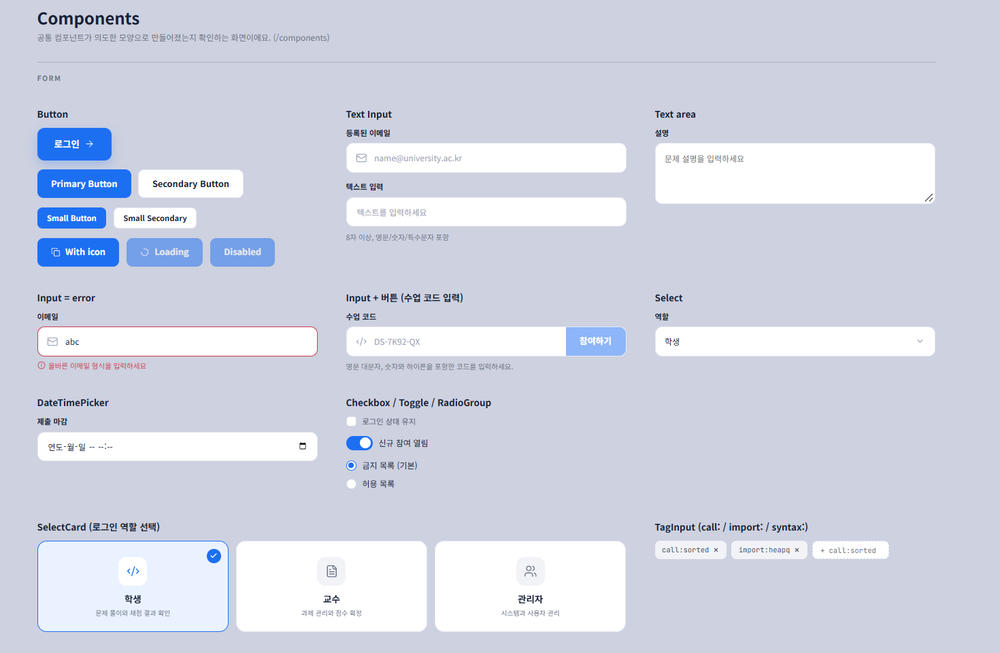
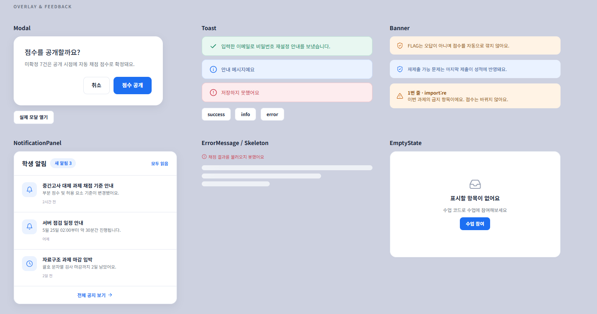
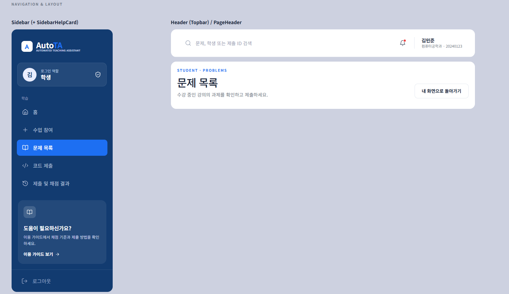
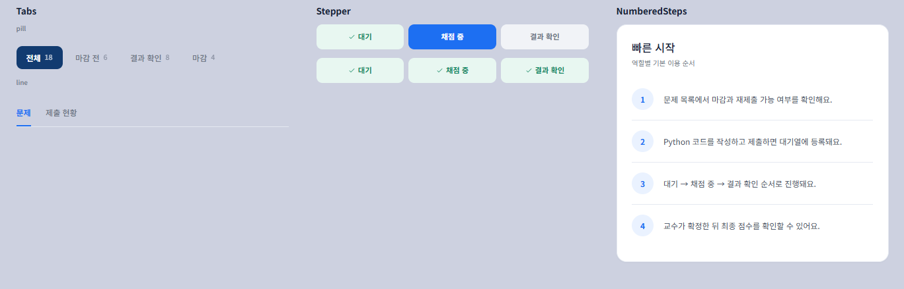
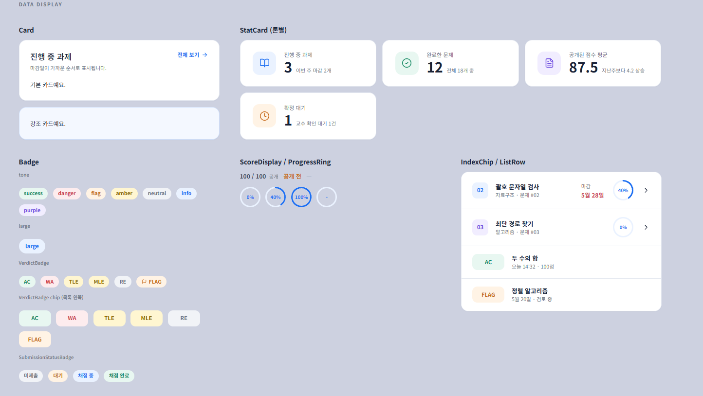
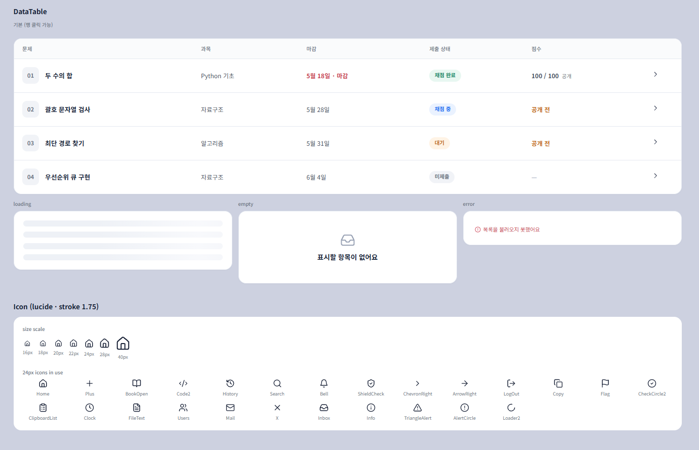
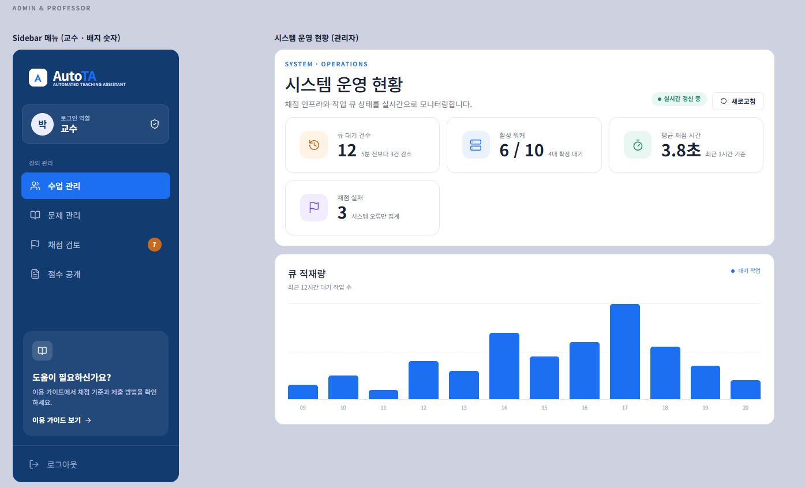
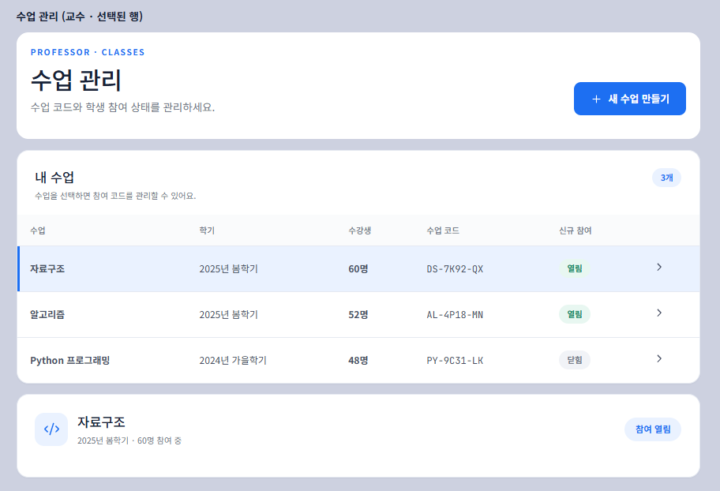
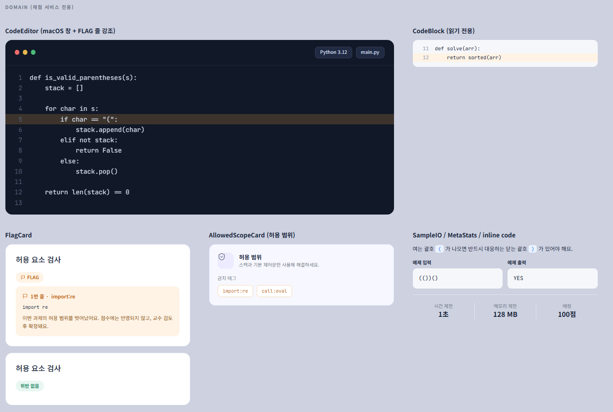
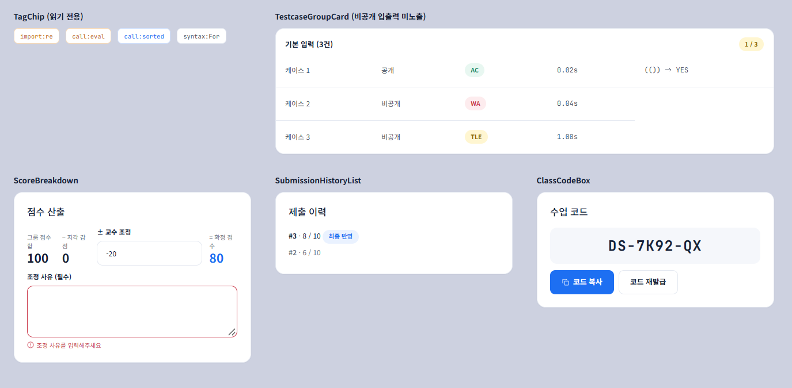

# FE

AutoTA FE 레포지토리입니다.

화면을 만들기 전에 공통 컴포넌트를 먼저 정리해 두었습니다.

## 기술 스택

| 구분   | 사용                                                             |
| ------ | ---------------------------------------------------------------- |
| 빌드   | Vite 5                                                           |
| UI     | React 18 + TypeScript 5                                          |
| 라우팅 | react-router-dom 6                                               |
| 아이콘 | lucide-react (stroke 1.75)                                       |
| 폰트   | Noto Sans KR (400 / 500 / 700), JetBrains Mono                   |
| 스타일 | 전역 CSS (`tokens.css` 변수 + `components.css`의 `.cl-*` 클래스) |

## 시작하기

```bash
git clone https://github.com/pproject-AutoTA/FE.git
cd FE
npm install
npm run dev
```

실행 후 `http://localhost:5173/components` 에서 공통 컴포넌트를 한눈에 볼 수 있습니다. 그 외 주소는 이 화면으로 이동합니다.

| 주소          | 화면                                       |
| ------------- | ------------------------------------------ |
| `/components` | 컴포넌트 갤러리                            |
| `/showcase`   | 서비스 화면 예시 (정식 화면으로 교체 예정) |

## 폴더 구조

```
src/
├─ main.tsx                  # 진입점, 라우터, ToastProvider
├─ styles/
│  ├─ tokens.css             # 색, 글꼴, 간격, 둥글기, 그림자 변수
│  ├─ components.css         # 공통 컴포넌트 스타일 (.cl-*)
│  └─ gallery.css            # /components 화면 전용 (.gl-*)
├─ pages/
│  └─ ComponentGallery.tsx   # 컴포넌트 갤러리
└─ components/
   ├─ layout/                # 화면 뼈대: AppShell, Sidebar, Topbar, PageHeader ...
   ├─ ui/                    # 범용 UI: Button, FormField, Card, DataTable, Toast ...
   └─ domain/                # 채점 서비스 전용: CodeEditor, ScoreDisplay, FlagCard ...
```

한 파일에 컴포넌트 하나를 두고, 각 폴더의 `index.ts`가 `export * from "./X"` 로 다시 내보냅니다. 따라서 어디서든 아래처럼 불러올 수 있습니다.

```tsx
import { Button, Card, ScoreDisplay } from "../components";
```

## 디자인 기준

- 디자인 원본: [AutoTA Figma Make](https://www.figma.com/make/OlfzBPA1OLLboDl6eOhRVD/AutoTA-Design?fullscreen=1&t=xaXvqQknl5TyDucg-1&code-node-id=0-6)
- Figma Make로 만든 AutoTA 화면(로그인, 홈, 문제 목록, 코드 제출, 교수·관리자 화면)에서 색과 크기를 뽑아 맞췄습니다.
- 주요 색: 네이비 `#123B70`(사이드바), 파랑 `#1D6FF2`(포인트), 배경 `#F5F7FB`.
- 주요 크기: 사이드바 384px, 상단바 105px, 버튼 sm 42 / md 56 / lg 64, 입력창 58px, 카드 모서리 20px.
- 상태 색은 성공 초록, 오류 빨강, FLAG 주황, 안내 파랑, 보라, 중립 회색으로 나눠 쓰며, 모두 `tokens.css`에 변수로 정의되어 있습니다.

## 컴포넌트 목록

### Form

버튼, 텍스트 입력, 텍스트 영역, 오류 입력, 입력창 + 버튼(수업 코드), 셀렉트, 날짜·시간, 체크박스, 토글, 라디오, 역할 선택 카드, 태그 입력.



### Overlay & Feedback

모달, 토스트, 배너, 알림 패널, 오류 메시지, 스켈레톤, 빈 상태.

토스트는 연한 색 배경에 같은 색 테두리와 글자, 선 아이콘 모양입니다. 성공은 초록, 안내는 파랑, 오류는 빨강입니다.



### Navigation & Layout

사이드바(로고, 역할 카드, 메뉴, 도움말 카드, 로그아웃), 상단바, 페이지 헤더, 탭(pill / line), 스테퍼, 번호 목록.





### Data Display

카드, 통계 카드(파랑·초록·보라·주황), 배지, 판정 배지(AC / WA / TLE / MLE / RE / FLAG), 제출 상태 배지, 점수 표시, 진행률 링, 번호 칩, 목록 행.



데이터 테이블은 기본, 로딩, 빈 상태, 오류 네 가지 상태를 지원합니다. 아이콘은 lucide 24px, stroke 1.75로 통일했습니다.



### Admin & Professor

관리자 화면의 운영 현황(통계 카드, 실시간 갱신 배지, 막대 차트)과 교수 화면의 사이드바(숫자 배지), 수업 관리 표(선택된 행)를 맞춰 두었습니다.





### Domain (채점 서비스 전용)

코드 에디터(FLAG 줄 강조), 읽기 전용 코드 블록, FLAG 카드, 허용 범위 카드, 예제 입출력, 태그 칩, 테스트케이스 그룹 카드, 점수 산출, 제출 이력, 수업 코드 박스.





## 서비스 규칙을 코드에 넣은 부분

- **점수 숨김**: `ScoreDisplay`가 점수 노출을 한곳에서 처리합니다. 교수가 공개하기 전(`released=false`)에는 점수가 전달되어도 숫자를 그리지 않고 "공개 전"으로 표시합니다. 미제출이면 "—"로 표시합니다.
- **비공개 테스트케이스**: `TestcaseGroupCard`는 비공개 케이스의 입력과 정답을 절대 그리지 않습니다.
- **FLAG**: 허용되지 않은 요소를 사용한 경우의 표시입니다. 주황색으로 보여주며, 점수는 자동으로 깎지 않습니다.

## 개발 메모

- CSS import 오류가 나면 `src/vite-env.d.ts` 에 `/// <reference types="vite/client" />` 가 있는지 확인하세요.
- 폴더 이름은 `components` (복수형)입니다.
- 새 컴포넌트를 만들면 해당 폴더의 `index.ts`에 한 줄 추가하고, `/components` 화면에도 예시를 넣어 주세요.
